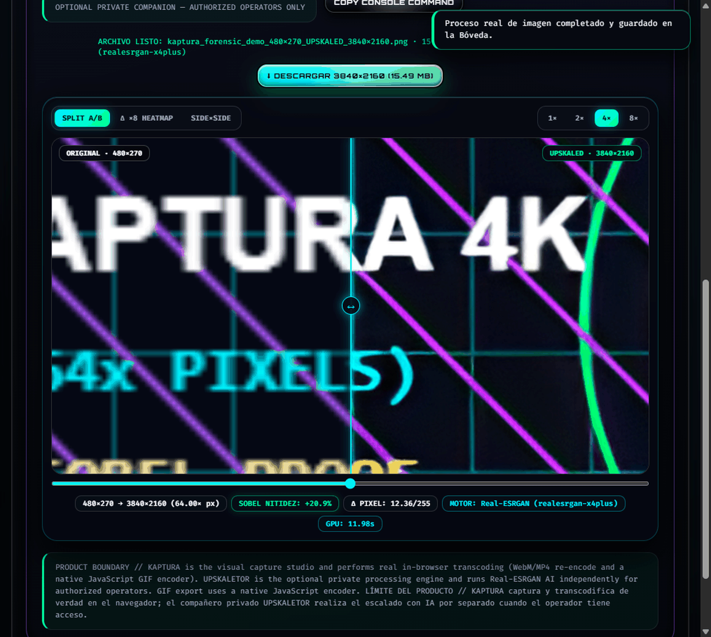
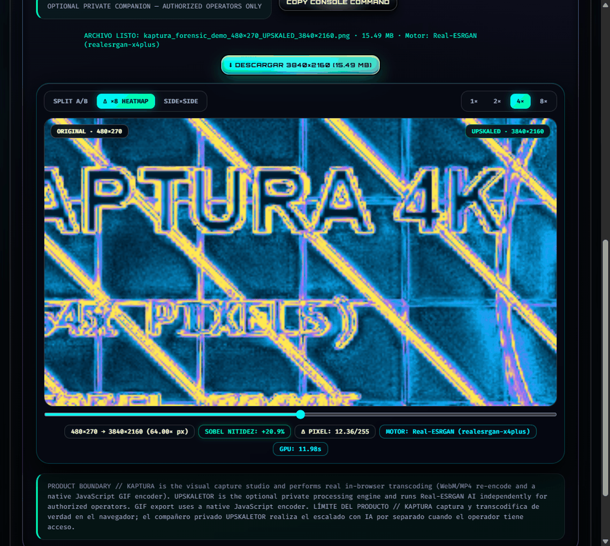
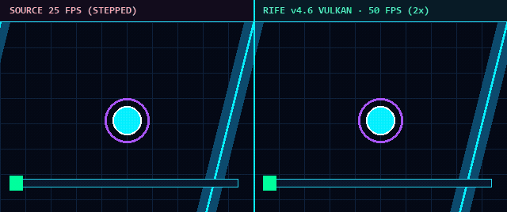

# 🚀 KAPTURA by Ethernium — Official Launch Kit (v3.0.0)

> **CHRONO Capture Studio · Real In-Browser Transcoding, Local GPU Daemon (`:3370`), 3-Motor Pipeline & Forensic Optical Inspector**
>
> Public Live Studio: [`https://nullalabs.github.io/KAPTURA-by-Ethernium/`](https://nullalabs.github.io/KAPTURA-by-Ethernium/) · Authored by **Steve Blackbeard / NullaLabs / Ethernium** (**Nemeth Corp.**)

---

## 🖼️ Visual Showcase Gallery

### 1. Interactive Forensic Optical Inspector (`SPLIT A/B` · `4×` Real-ESRGAN x4plus)


### 2. Amplified `Δ ×8 HEATMAP` & Live Sobel / Pixel Telemetry (`+20.9%` Sharpness · `Δ 12.36/255`)


### 3. Real `RIFE v4.6` Vulkan 2× Temporal Interpolation vs Stepped Source


---

## 📊 Verified Ground-Truth Benchmarks (`RTX 3070 Laptop GPU`)

Reproducible locally via `npm run benchmark` against an independent `1280×720 @ 30fps` lossless master + `48 kHz` stereo AAC track downscaled 4× to `320×180 @ 30fps` (see [`BENCHMARK_PROOF.md`](BENCHMARK_PROOF.md)):

| Engine / Pipeline | Output Stream | SSIM ↑ | PSNR (dB) ↑ | VMAF ↑ | FPS Drift ↓ | Duration Drift | Audio AAC | GPU Time |
| :--- | :--- | :---: | :---: | :---: | :---: | :---: | :---: | :---: |
| Baseline Bicubic (FFmpeg) | `1280x720 @ 30fps` | 0.5830 | 21.05 | 51.66 | 0% | 0 ms | PRESERVED | 0.34s |
| **Motor 1: Lanczos-3 + Multi-Scale CAS (`h264_nvenc`)** | `1280x720 @ 30fps` | **0.5867** | **21.37** | **62.39** | **0%** | **0 ms** | **PRESERVED** | **0.64s** |
| **Motor 2: Real-ESRGAN `x4plus` (Vulkan)** | `1280x720 @ 30fps` | **0.7356** | 20.75 | 36.66 | 0% | 10 ms | PRESERVED | 18.68s |
| **Motor 2 Fast: Real-ESRGAN `v3` (Vulkan)** | `1280x720 @ 30fps` | 0.6141 | 19.76 | 23.39 | 0% | 10 ms | PRESERVED | 8.15s |
| **Motor 3: RIFE v4.6 `2×` FPS (Vulkan)** | `320x180 @ 60fps` | 0.5780 | 21.03 | 50.00 | **0%** | 10 ms | PRESERVED | 6.09s |
| **HYBRID ULTRA: ESRGAN `v3` + RIFE `v4.6`** | `1280x720 @ 60fps` | 0.6145 | 19.76 | 23.37 | **0%** | 10 ms | PRESERVED | 20.52s |

> **Honest Architecture Boundary:** Public KAPTURA runs real in-browser capture, transcoding, pure-JS GIF89a encoding (`median-cut` + `Floyd-Steinberg` + `LZW`), SVG vector tracing, WebGL Lanczos-3 + CAS, and client Sobel/Δ×8 inspection with zero external CDNs or telemetry. When local `realesrgan-ncnn-vulkan` / `rife-ncnn-vulkan` or the optional private companion `UPSKALETOR` for authorized operators are present, the local `:3370` daemon executes them natively on GPU with operator cancelation (`POST /cancel/:taskId`) and frame-level SSE progress; otherwise KAPTURA hands off the untouched master and signed CLI command without faking progress bars.

---

## 📢 Ready-to-Publish Launch Copy (EN & ES)

### 1. GitHub Release Notes (v3.0.0+)

#### English
```markdown
## KAPTURA by Ethernium — Capture, Local GPU Daemon & Forensic Optical Inspector

Try the Zero-Install Static Studio directly in your browser:
https://nullalabs.github.io/KAPTURA-by-Ethernium/

### Highlights
- **Real In-Browser Media Studio:** Screen/tab capture, WebCodecs/MediaRecorder transcoding, budget-targeted Smart Compressor, pure JavaScript GIF89a encoder (`median-cut` + `Floyd-Steinberg` + `LZW` + temporal sub-rect optimization), and SVG path vectorizer (`<path>` / SMIL flip-book).
- **Forensic Optical Inspector (`SPLIT A/B`, `Δ ×8 HEATMAP`, `SIDE×SIDE`):** Native Hi-DPI comparison with `1×–8×` loupe auto-snap, frame stepping (`-1f` / `+1f`), live Sobel edge sharpness percentage, mean pixel delta, and daemon header telemetry.
- **Optional Local GPU Daemon (`127.0.0.1:3370`):** WebSocket capture straight to disk (`RFC 6455`, zero external npm deps), NVENC/AMF/QSV hardware transcoding, AMD FidelityFX `cas`, Real-ESRGAN Vulkan, RIFE v4.6 temporal interpolation, granular frame-by-frame SSE progress, and clean mid-flight operator cancelation (`POST /cancel/:taskId`).
- **Reproducible Ground-Truth Benchmarks (`npm run benchmark`):** Measured SSIM/PSNR/VMAF results with 0% FPS drift, preserved AAC audio, and 0 leaked temp files (`BENCHMARK_PROOF.md`).
```

#### Español
```markdown
## KAPTURA by Ethernium — Estudio de Captura, GPU Daemon Local e Inspector Óptico Forense

Prueba el estudio estático Zero-Install directamente en tu navegador:
https://nullalabs.github.io/KAPTURA-by-Ethernium/

### Novedades principales
- **Estudio multimedia real en navegador:** Captura de pantalla/pestaña, transcodificación WebCodecs/MediaRecorder, compresor inteligente por presupuesto MB, codificador GIF89a puro en JavaScript (`median-cut` + `Floyd-Steinberg` + `LZW` con optimización temporal) y vectorizador SVG real.
- **Inspector Óptico Forense (`SPLIT A/B`, `Δ ×8 HEATMAP`, `SIDE×SIDE`):** Comparación Hi-DPI nativa con lupa `1×–8×`, salto exacto frame a frame, cálculo real de nitidez Sobel (`+%`) y delta medio por píxel.
- **GPU Daemon Local Opcional (`127.0.0.1:3370`):** Captura directa a disco por WebSocket (`RFC 6455`, cero dependencias npm externas), NVENC/AMF/QSV, AMD FidelityFX `cas`, Real-ESRGAN Vulkan, RIFE v4.6 (`2× FPS`), progreso SSE por fotograma y cancelación limpia (`POST /cancel/:taskId`).
- **Benchmarks Ground-Truth reproducibles (`npm run benchmark`):** Métricas SSIM/PSNR/VMAF auditables, `0%` drift de FPS y audio AAC preservado (`BENCHMARK_PROOF.md`).
```

---

### 2. X / Twitter Thread

**EN (3-Post Thread):**
> **1/3** Built **KAPTURA v3.0**: a zero-install local-first capture studio + optional `:3370` GPU daemon + real-time **Forensic Optical Inspector** (`SPLIT A/B`, `Δ ×8` thermal heatmap, `1×–8×` loupe, live Sobel edge delta).
> No cloud uploads. No fake AI progress bars. Try it in Chrome/Edge: https://nullalabs.github.io/KAPTURA-by-Ethernium/
>
> **2/3** Most upscalers shrink both clips into a tiny player so every output looks identical.
> KAPTURA compares native Hi-DPI buffers with a draggable curtain, auto-snaps loupe `4×` on 4K outputs, amplifies per-pixel deltas `×8` thermally, measures Sobel edge gain (`+20.9%` / `+21.0%`), and audits daemon headers (`X-Kaptura-Out-Res`, `X-Kaptura-Out-Fps`, audio AAC, duration drift).
>
> **3/3** Run `node daemon/server.mjs` locally for NVENC + Multi-Scale `cas` (`VMAF 62.39` in `0.64s`), Real-ESRGAN Vulkan (`SSIM 0.7356`), RIFE v4.6 `2× FPS`, live frame-by-frame SSE progress, & clean GPU process cancelation.
> Repo + reproducible SSIM/PSNR/VMAF suite: https://github.com/NullaLabs/KAPTURA-by-Ethernium

**ES (Hilo):**
> **1/3** Lanzamos **KAPTURA v3.0**: estudio de captura 100% local Zero-Install + GPU Daemon opcional (`:3370`) + **Inspector Óptico Forense** (`SPLIT A/B`, mapa térmico `Δ ×8`, lupa `1×–8×` y cálculo real de nitidez Sobel).
> Cero nube. Cero barras falsas. Pruébalo directo: https://nullalabs.github.io/KAPTURA-by-Ethernium/
>
> **2/3** Comparar vídeos `720p` y `4K` encogidos en una caja engaña al ojo. KAPTURA muestra un mapa térmico `Δ ×8` real píxel a píxel, engancha zoom `4×` en 4K, mide ganancia Sobel (`+20.9%`) y audita cada cabecera de salida del daemon (FPS, drift temporal en ms y pista AAC).
>
> **3/3** Con el daemon local `:3370`: NVENC + `unsharp+cas` (`VMAF 62.39` en `0.64s`), Real-ESRGAN Vulkan (`SSIM 0.7356`), RIFE v4.6 `2× FPS`, progreso SSE por frame y cancelación inmediata de GPU.
> Código y prueba Ground-Truth reproducible: https://github.com/NullaLabs/KAPTURA-by-Ethernium

---

### 3. Reddit (`r/selfhosted`, `r/videoediting`, `r/LocalLLaMA`)

**Title:** `KAPTURA v3.0: Local-first browser capture & media studio + optional Node GPU daemon (:3370) with NVENC/CAS, Real-ESRGAN, RIFE v4.6 & a Forensic Pixel/Sobel Inspector`

> We got tired of screen tools that either rely on remote servers or upscale clips with no transparent way to inspect whether frames actually gained edge detail or simply bloated file size.
>
> **KAPTURA by Ethernium** splits cleanly into two honest layers:
> 1. **Static Zero-Install Browser Studio** (https://nullalabs.github.io/KAPTURA-by-Ethernium/): zero external npm runtime deps and self-hosted fonts. Includes Screen/Tab capture, WebCodecs/MediaRecorder transcoding, budget-targeted Smart Compressor, pure-JS GIF89a encoder (`median-cut` + `Floyd-Steinberg` + `LZW`), SVG vector tracer, WebGL Lanczos-3 + CAS, and the **Forensic Optical Inspector** (`SPLIT A/B`, `Δ ×8` thermal heatmap, `1×–8×` zoom, live Sobel edge sharpness % + mean pixel delta).
> 2. **Optional Local GPU Daemon (`http://127.0.0.1:3370`)**: WebSocket capture straight to disk (`RFC 6455`), FFmpeg NVENC/AMF/QSV encoding, Real-ESRGAN Vulkan, RIFE v4.6 `2×` frame interpolation, frame-level SSE progress, and cancelable GPU subprocess trees (`POST /cancel/:taskId`). Note: optional private companion orchestration (`UPSKALETOR`) is separated clearly for authorized operators—without binaries installed, KAPTURA hands off the clean master and CLI command instead of pretending AI ran.
>
> Repo + reproducible SSIM/PSNR/VMAF benchmark script (`npm run benchmark`): https://github.com/NullaLabs/KAPTURA-by-Ethernium

---

### 4. Hacker News (`Show HN`)

**Title:** `Show HN: KAPTURA – Zero-install browser video studio + local GPU daemon (:3370) with Sobel/Δ×8 optical inspector`

> Hi HN — we built KAPTURA as a local-first web studio (`https://nullalabs.github.io/KAPTURA-by-Ethernium/`) paired with an optional dependency-free Node GPU daemon (`127.0.0.1:3370`).
>
> Technical highlights:
> - **Pure-JS Studio:** Zero third-party CDNs or external npm packages. Custom GIF89a encoder (`median-cut` quantizer + Floyd-Steinberg dithering + LZW + temporal sub-rect delta coalescing), real SVG path tracing, and separable Lanczos-3 + AMD FidelityFX `cas` in WebGL.
> - **Forensic Optical Inspector:** Instead of shrinking two videos into side-by-side thumbnails, it computes per-pixel `Δ ×8` thermal maps and Sobel gradient delta on canvas buffers, adds a `1×–8×` auto-snapping loupe, and inspects daemon response headers (`X-Kaptura-Out-Res`, `X-Kaptura-Out-Fps`, duration drift ms, AAC preservation).
> - **Local GPU Pipeline (`:3370`):** Custom RFC 6455 WebSocket disk streaming, hardware NVENC/AMF/QSV detection, chunked `realesrgan-ncnn-vulkan` & `rife-ncnn-vulkan` execution with stderr progress parsed to SSE events, and clean child-process-tree cancelation.
> - **Ground-Truth Benchmark Proof:** `npm run benchmark` generates a deterministic `1280×720 @ 30fps` + AAC master, degrades 4×, runs each pipeline, and computes FFmpeg SSIM/PSNR/VMAF while asserting 0 leaked scratch files (`BENCHMARK_PROOF.md`).
>
> Source: https://github.com/NullaLabs/KAPTURA-by-Ethernium
