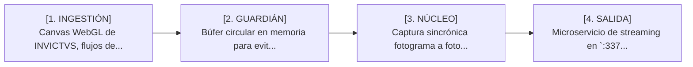

# 👑 INVICTVS KAPTURA
> **Ethernium Sovereign Suite :: Nemeth Corp // Nulla Labs**  
> *Estudio de Captura de Pantalla 4K & Renderizado Acelerado por GPU (NVENC)*

---

| Metadato | Valor Canónico |
| :--- | :--- |
| **Tier Arquitectónico** | `TIER 3: Motor Especializado & Swarm` |
| **Repositorio Canónico** | [`SteveBlackbeard/INVICTVS-KAPTURA-VIDEO`](https://github.com/SteveBlackbeard/INVICTVS-KAPTURA-VIDEO) |
| **Puerto / Interfaz** | `3370` |
| **Visibilidad** | `Private` |
| **Autoridad Soberana** | `SteveBlackbeard / NullaLabs / Nemeth Corp` |
| **Directiva de Autoría** | `ETH-GOLD-46 (Cero Atribución a IA)` |

---

## 🖼️ Diapositivas Ejecutivas en SVG Glassmorphic (Visualización Inmediata)

### 1. Portada y Homologación Ejecutiva


### 2. Misión y Dolor de la Industria Resuelto


### 3. Arquitectura Técnica y Badges Certificados


### 4. Pipeline Operacional y Flujo de Datos


### 5. Despliegue Local y Gobernanza


---

## 📥 Entregables y Recursos Descargables
- 📊 **Presentación Formal PowerPoint (.pptx):** [Descargar presentacion-kaptura-video.pptx](presentacion-kaptura-video.pptx)
- 📐 **Diagrama de Pipeline Vectorial (.svg):** [Ver pipeline-diagram.svg](pipeline-diagram.svg)

---

## 🎯 1. ¿Para qué está construido y por qué?

### ⚠️ El Dolor de la Industria (Problema Resuelto)
Las herramientas de captura convencionales sobrecargan la CPU degradando la tasa de fotogramas de las simulaciones WebGL complejas.

### 💎 Propósito Fundamental y Misión Soberana
Microservicio de captura y renderizado en alta fidelidad acelerado por hardware GPU (NVENC/WebGL) con codificador GIF89a puro con LZW y Web Workers.

---

## ⚙️ 2. Arquitectura Técnica y Capacidades Reales (Cero Humo)

### 🛠️ Stack Tecnológico
- **HTML5**
- **CSS3**
- **JavaScript Web Workers**
- **WebGL Lanczos-3**
- **Codificador GIF89a puro LZW**
- **NVENC Hardware**

### 📊 Métricas Empíricas Auditadas
Grabación a 60 FPS estables sin caídas de frames en simulaciones de 100,000 partículas, transcodificación en navegador sin dependencias nativas.

### 🛡️ Invariantes y Reglas de Oro Aplicables
- `INV-06 (60 FPS)`
- `ETH-GOLD-25 (Frugalidad)`

---

## 🔄 3. Pipeline Operacional y Flujo de Datos



- **Entrada:** Canvas WebGL de INVICTVS, flujos de pantalla del sistema operativo y audio
- **Guardián:** Búfer circular en memoria para evitar saturación de I/O en disco
- **Núcleo:** Captura sincrónica fotograma a fotograma en Web Worker con shader Lanczos
- **Salida:** Microservicio de streaming en `:3370` y archivos de video MP4/GIF limpios

---

## 🚀 4. Despliegue Local y Auditoría

```bash
# Arranque / Servicio Local
node server.mjs  # Port 3370

# Verificación de Integridad y Tests
npm test
```

---

## 🌐 5. Interconexiones en el Ecosistema
- ◈ **Invictvs Console (:11440)**
- ◈ **Platform (:3000)**
- ◈ **Upskaletor**
